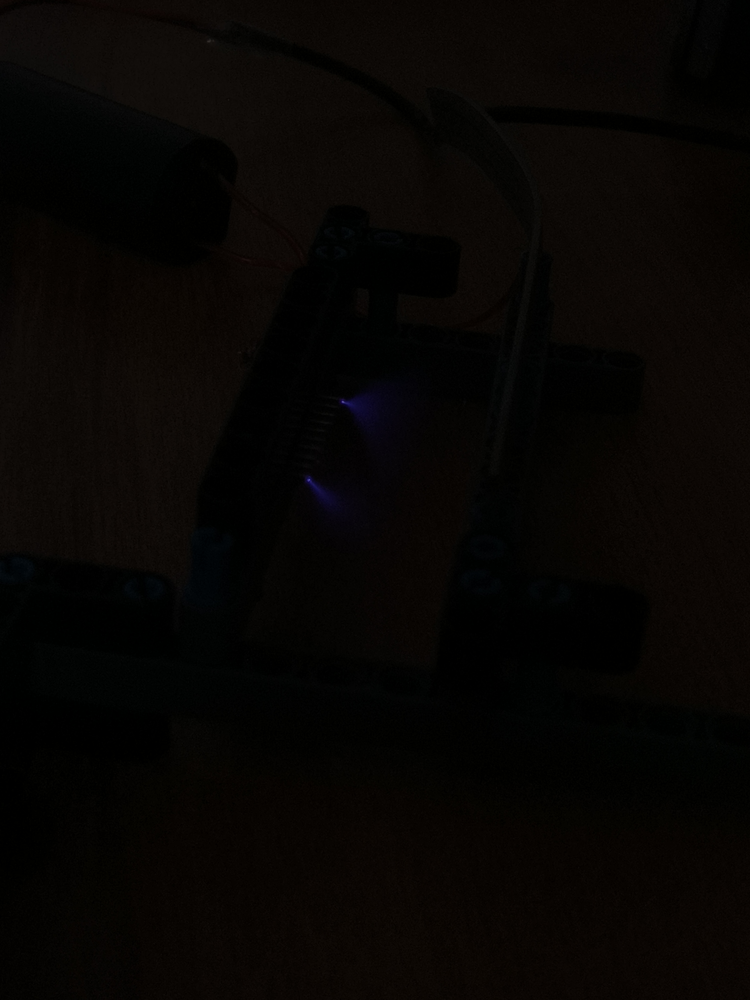

# ⚡ High-Voltage Electrohydrodynamic (Ionic) Solid-State Thruster

[]()
[]()
[]()
[](LICENSE)

> **An experimental solid-state aerospace propulsion system generating aerodynamic thrust with ZERO moving parts.**  
> Utilizes **corona discharge** and the **Biefeld-Brown effect** across an asymmetric capacitor geometry (ultra-thin copper corona emitter wire and smooth aluminum foil collector skirt) powered by a 30kV DC high-voltage resonant flyback power supply.

---

## 📸 Experimental Validation

| Violet Corona Discharge in Darkness | High-Resolution RAW Thruster Assembly |
| :---: | :---: |
|  |  |
| *Intense violet ionization plasma glow along emitter wire* | *Asymmetric electrode gap & balsa frame* |

---

## 🔬 Electrohydrodynamic Physics

```
[ High Voltage Anode (+30kV) ] ──> Ultra-Thin Copper Wire (0.08mm)
                                          │
                                 [ Corona Discharge ]
                                (Electric Field > 30 kV/cm)
                                          │
                                          ▼
                         Ionized Air Molecules (N2+, O2+)
                                          │
                                          ▼ Momentum Transfer Collisions
                                 [ Downward Ionic Wind ]
                                          │
                                          ▼
[ Grounded Cathode (0V) ] ──────> Smooth Aluminum Foil Collector
```

### Momentum Transfer Equation
$$F_{\text{EHD}} = \frac{I \cdot d}{\mu_i}$$
where $I$ is corona current ($1.2\text{ mA}$), $d$ is electrode gap ($40\text{ mm}$), and $\mu_i$ is ion mobility in air ($1.8 \times 10^{-4}\text{ m}^2/\text{V}\cdot\text{s}$).

---

## 📂 Repository Directory Structure

```text
Solid-State-Ionic-Thruster/
├── README.md                           # Master physics manual, EHD derivations & photos
├── schematics/
│   └── high_voltage_zvs_circuit.md     # ZVS resonant flyback & Cockcroft-Walton multiplier
├── docs/
│   └── electrohydrodynamic_physics.md  # Townsend breakdown & momentum transfer equations
├── calculations/
│   └── ehd_thrust_calculator.py        # Python script calculating theoretical lift vs voltage
├── safety/
│   └── high_voltage_laboratory_safety.md # 30kV safety, grounding wand & ozone mitigation
└── media/
    ├── corona_discharge_night.jpg      # Photograph of active purple corona discharge
    └── thruster_assembly_raw.dng       # RAW image of electrode assembly
```

---
## 📜 License
Open-source under the [MIT License](LICENSE).
